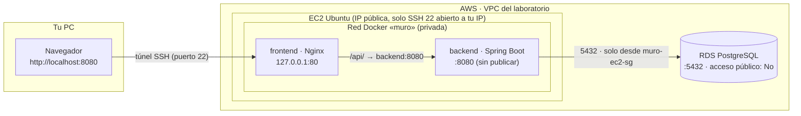

# T03 · Docker: del IDE al laboratorio

Tercera parte del bloque Docker. En **T01** viste los fundamentos y en **T02** cómo operar y diagnosticar fallos. Aquí partes de un programa que **ya funciona en tu IDE**, escribes tú los ficheros de Docker entendiendo cada decisión, lo subes a GitHub y lo despliegas en AWS.

> El objetivo es **entender Docker en un despliegue real**, no programar. No tienes que tocar el código Java ni la web.

**Tiempo estimado:** unas 2 horas (alrededor de 1 hora en el laboratorio).

Los pasos que tratan Docker empiezan con **"El mapa"**: la idea general y para qué sirve cada fichero. Léelo antes de escribir nada; después, cada línea tendrá un sitio donde encajar. El resto de pasos tienen tres partes: **Por qué**, **Qué hacer** y **Hecho cuando**.

## Índice

0. [Qué vas a conseguir](#0-qué-vas-a-conseguir)
1. [Crear tu repositorio y ejecutar el programa en el PC](#1-crear-tu-repositorio-y-ejecutar-el-programa-en-el-pc)
2. [Decisiones de arquitectura](#2-decisiones-de-arquitectura)
3. [Backend: `.dockerignore` y `Dockerfile`](#3-backend-dockerignore-y-dockerfile)
4. [Frontend: `Dockerfile`, `.dockerignore` y `nginx.conf`](#4-frontend-dockerfile-dockerignore-y-nginxconf)
5. [`docker-compose.yml` de desarrollo](#5-docker-composeyml-de-desarrollo)
6. [`docker-compose.lab.yml` para el laboratorio](#6-docker-composelabyml-para-el-laboratorio)
7. [Subir a GitHub](#7-subir-a-github)
8. [Preparar AWS: grupos de seguridad, RDS y EC2](#8-preparar-aws-grupos-de-seguridad-rds-y-ec2)
9. [Instalar Docker en la EC2](#9-instalar-docker-en-la-ec2)
10. [Desplegar](#10-desplegar)
11. [Acceder desde tu PC por túnel SSH](#11-acceder-desde-tu-pc-por-túnel-ssh)
12. [Demostrar que los datos están fuera del contenedor](#12-demostrar-que-los-datos-están-fuera-del-contenedor)
13. [Actualizar la aplicación](#13-actualizar-la-aplicación)

- [Resumen de ficheros](#resumen-de-ficheros)

---

## 0. Qué vas a conseguir

Al terminar tendrás el **Muro de notas** (una pizarra de post-its compartida) funcionando en AWS:

- Dos contenedores en una instancia **EC2**: **Nginx** (sirve la web y reenvía la API) y **Spring Boot** (la API).
- La base de datos en **RDS PostgreSQL**, fuera de los contenedores y sin acceso público.
- Acceso desde tu navegador a través de un **túnel SSH**: la web no está abierta a Internet.

### Requisitos previos

- Cuenta de **GitHub** y **Git** instalado en tu PC.
- **Java 21** o superior en tu PC.
- Un IDE: IntelliJ IDEA, VS Code o Eclipse/STS.
- Acceso al **laboratorio de AWS Academy**.
- _Opcional:_ Docker Desktop en tu PC (solo para probar el paso 5).

### Vocabulario mínimo

Antes de seguir, fija estas palabras. Se confunden mucho y el resto de la guía las usa con este significado exacto.

| Palabra                      | Qué es                                                                                                             | Comparación                              |
| ---------------------------- | ------------------------------------------------------------------------------------------------------------------ | ---------------------------------------- |
| **Imagen**                   | Plantilla cerrada con todo lo necesario para ejecutar un programa. No está en marcha.                              | El molde                                 |
| **Contenedor**               | Una imagen **en marcha**. De una imagen puedes sacar muchos contenedores.                                          | La pieza sacada del molde                |
| **Dockerfile**               | Receta para fabricar una imagen.                                                                                   | La receta                                |
| **Capa**                     | Cada "piso" de una imagen. Algunas instrucciones del Dockerfile añaden uno.                                        | Los pisos de un edificio                 |
| **Contexto de construcción** | Los ficheros de tu carpeta que Docker recibe para construir.                                                       | Los ingredientes que entran en la cocina |
| **`.dockerignore`**          | Lista de ficheros que **no** entran en el contexto.                                                                | Lo que se queda fuera de la cocina       |
| **Docker Compose**           | Herramienta que levanta varios contenedores juntos a partir de un fichero `docker-compose.yml`.                    | El plano del conjunto                    |
| **Volumen**                  | Almacenamiento que sobrevive aunque borres el contenedor.                                                          | Un disco externo                         |
| **Variable de entorno**      | Un dato (dirección, usuario, contraseña) que el contenedor recibe **al arrancar**, sin estar escrito en el código. | Una nota que se le da al empezar         |

### El recorrido

```
  Tu PC (IDE)  ──git push──►  GitHub  ──git clone──►  EC2  ──docker compose──►  contenedores  ──►  RDS
  pasos 1-6                   paso 7                  pasos 8-9                 pasos 10-13
```

### Arquitectura final



Si tu visor no dibuja el gráfico anterior, este es el mismo esquema en texto:

```
 Tu PC                          EC2 (Ubuntu)                                  RDS
┌────────────┐  túnel SSH  ┌──────────────────────────────────────────┐  5432  ┌────────────┐
│ Navegador  │────(22)────►│ Nginx (frontend)  ──/api/──►  Spring Boot │──────►│ PostgreSQL │
│ :8080      │             │ 127.0.0.1:80                 (sin puertos)│        │ privada    │
└────────────┘             └──────────────────────────────────────────┘        └────────────┘
```

Qué es público y qué es privado:

| Elemento                  | ¿Accesible desde Internet?                                                 |
| ------------------------- | -------------------------------------------------------------------------- |
| Puerto 22 (SSH) de la EC2 | Sí, **solo desde tu IP** (y desde EC2 Instance Connect)                    |
| Nginx (frontend)          | **No**: escucha en `127.0.0.1:80` de la EC2; se llega por el túnel         |
| Spring Boot (backend)     | **No**: no publica ningún puerto; solo lo ve Nginx dentro de la red Docker |
| RDS                       | **No**: acceso público desactivado; solo admite conexiones desde la EC2    |

---

## 1. Crear tu repositorio y ejecutar el programa en el PC

### Por qué

Antes de meter nada en un contenedor, tienes que saber que **el programa funciona**. Si después algo falla, sabrás que el problema está en Docker o en AWS, no en el código.

### Qué hacer

**1. Crea tu repositorio desde la plantilla.**

1. Entra en el repositorio plantilla que te ha pasado el profesor y pulsa **Use this template → Create a new repository**.
2. Ponle un nombre (por ejemplo, `muro-notas`).
3. Deja **DESMARCADA** la casilla **Include all branches**.
4. Elige **Public**, así podrás clonarlo en la EC2 sin configurar credenciales.

**2. Clónalo en tu PC y ábrelo en el IDE.** Clónalo en una carpeta que **no** esté dentro de otro repositorio.

```bash
git clone https://github.com/<tu-usuario>/<tu-repo>.git
cd <tu-repo>
```

**3. Ejecuta el programa con el perfil `local`.** Este perfil usa una base de datos **H2 en memoria** (no necesitas PostgreSQL) y Spring sirve también la web, así que todo está en un solo puerto.

Windows (PowerShell). El argumento `-D` **va entre comillas**; si no, PowerShell lo trocea y Maven da un error:

```powershell
cd backend
.\mvnw.cmd spring-boot:run "-Dspring-boot.run.profiles=local"
```

Linux / macOS:

```bash
cd backend
./mvnw spring-boot:run -Dspring-boot.run.profiles=local
```

Desde el IDE: crea una configuración de ejecución para `MuroNotasApplication` con la variable de entorno `SPRING_PROFILES_ACTIVE=local`.

> **Tarda unos 45 segundos** la primera vez. Cuando aparece `Started MuroNotasApplication in ... seconds`, la terminal se queda **"parada"**. No está colgada: el servidor está esperando peticiones.

**4. Abre <http://localhost:8080>.** Crea un par de notas, dale a like y borra una. Abre también <http://localhost:8080/api/estado>.

### Hecho cuando

- La web carga con la franja **verde**: `API: OK · BD: OK · contenedor: <nombre de tu PC>`.
- `/api/estado` devuelve algo como `{"api":"ok","bd":"ok","contenedor":"...","version":"1.0.0"}`.

Para el programa con `Ctrl+C` antes de seguir. Si no, el puerto 8080 seguirá ocupado.

---

## 2. Decisiones de arquitectura

### Por qué

Los ficheros que vas a escribir no son arbitrarios: cada línea responde a una de estas cuatro decisiones.

**1. Un contenedor por proceso.** Nginx y Spring Boot van en contenedores distintos. Cada uno tiene su imagen, sus logs y su ciclo de vida: puedes reconstruir el backend sin tocar el frontend, mirar los logs de uno sin mezclarlos con los del otro o reiniciar solo el que falla.

**2. La base de datos fuera, en RDS.** Un contenedor es **efímero**: lo borras y se pierde lo que tenía dentro. En el lab usamos **RDS**, una base de datos gestionada por AWS que no depende de tu EC2. Si borras los contenedores, o incluso la EC2, los datos siguen ahí. Es lo habitual en producción: los contenedores no guardan datos; los datos viven en un servicio aparte.

**3. Nginx delante, y el backend sin puertos publicados.** El navegador solo habla con Nginx. Nginx sirve la web y reenvía lo que empieza por `/api/` al backend por la red interna de Docker. Así:

- Web y API están en **la misma dirección**, y el navegador no pone pegas (no hay problemas de CORS).
- Nadie puede llegar al backend saltándose Nginx.
- Si mañana añades HTTPS, se hace en Nginx sin tocar el backend.

**4. La configuración en variables de entorno.** La **misma imagen** del backend sirve para tu PC y para el lab. Lo único que cambia es a qué base de datos se conecta, y ese dato no está escrito en el código: llega desde fuera, al arrancar.

### Cómo llega la configuración al programa

Esta cadena es la que más se confunde, así que mírala con calma:

```
.env (fichero)  ──►  Docker Compose  ──►  variables de entorno  ──►  Spring
                     lo lee al hacer        del contenedor            ${DB_HOST} en
                     "up" y rellena el      del backend               application.properties
                     bloque environment:
```

> **Confusión típica:** "Spring lee el `.env`". **No.** El `.env` lo lee **Docker Compose**. Si arrancas el programa en tu PC sin Docker, el `.env` no sirve de nada, aunque exista.

### Qué hacer

1. Abre `backend/src/main/resources/application.properties` y busca las líneas que empiezan por `spring.datasource`. Localiza qué variables de entorno usa (`DB_HOST`, `DB_PORT`, `DB_NAME`, `DB_USER`, `DB_PASSWORD`…) y cuáles tienen valor por defecto. La sintaxis `${DB_PORT:5432}` significa: "usa `DB_PORT` y, si no existe, `5432`".
2. **Compruébalo:** arranca el programa **sin** el perfil `local` (desde `backend`):
   ```powershell
   .\mvnw.cmd spring-boot:run
   ```
   Debe negarse a arrancar con `ERROR: falta la variable de entorno DB_HOST.` El programa necesita que alguien le diga dónde está la base de datos. En el lab se lo dirá Docker Compose.
3. Abre `.env.example` en la raíz: es la plantilla del `.env` que crearás en la EC2. Fíjate en qué valor tendrás que cambiar (`DB_HOST`).

### Hecho cuando

- Has visto el error del punto 2.
- Sabes responder en dos o tres líneas cada una:
  1. ¿Por qué Nginx y Spring van en contenedores separados?
  2. ¿Por qué en el lab la base de datos está en RDS y no en un contenedor?
  3. ¿Por qué el backend no publica ningún puerto?
  4. ¿Por qué la contraseña va en un `.env` y no en el código?

---

## 3. Backend: `.dockerignore` y `Dockerfile`

### El mapa

**El objetivo.** Queremos una **imagen** que contenga todo lo necesario para ejecutar el backend y **nada más**, para que funcione igual en tu PC, en la EC2 o en el ordenador de un compañero sin instalar Java en ninguno.

- **`Dockerfile`** = la receta para fabricar esa imagen.
- **`.dockerignore`** = lo que no se deja entrar en la cocina mientras se fabrica.

**Qué pasa cuando se construye la imagen** (`docker build`, o `docker compose up --build`):

```
Tu carpeta backend/
        │
        │ ① .dockerignore filtra: lo que no sirve no entra
        ▼
Contexto de construcción (lo que Docker recibe)
        │
        │ ② el Dockerfile se ejecuta en orden, instrucción a instrucción
        ▼
Imagen (la plantilla terminada)
        │
        │ ③ docker compose up
        ▼
Contenedor (la imagen en marcha)
```

**Las cinco preguntas de cualquier Dockerfile.** Da igual que sea Java, Node o PHP: todo Dockerfile responde a estas cinco preguntas.

| Pregunta                            | Instrucción            |
| ----------------------------------- | ---------------------- |
| ¿De qué imagen base parto?          | `FROM`                 |
| ¿Qué ficheros meto dentro?          | `COPY`                 |
| ¿Qué hay que hacer para prepararlo? | `RUN`                  |
| ¿Con qué usuario se ejecuta?        | `USER`                 |
| ¿Cómo se arranca?                   | `ENTRYPOINT` (o `CMD`) |

Además, `WORKDIR` elige la carpeta de trabajo **dentro de la imagen** y `EXPOSE` documenta el puerto.

**De código a programa en marcha.** Para entender por qué el Dockerfile tiene dos partes, hay que saber quién hace qué en Java:

```
 Código .java ──(Maven llama a javac del JDK)──► .class ──(Maven empaqueta)──► muro-notas.jar ──(JRE: java -jar)──► programa en marcha
 └────────────────────── hace falta JDK + Maven ──────────────────────────┘                    └─── basta con JRE ───┘
```

- **JDK** (_Java Development Kit_): el kit para **desarrollar**. Incluye el compilador `javac`, que traduce `.java` a `.class`.
- **Maven**: el director de orquesta. Lee el `pom.xml`, descarga las librerías, llama a `javac` para compilar y empaqueta el resultado. No compila él mismo: sin JDK no puede.
- **`.jar`**: un fichero comprimido con todo lo compilado (tu código y las librerías), listo para ejecutar.
- **JRE** (_Java Runtime Environment_): lo mínimo para **ejecutar** un `.jar`. No sabe compilar, pero no le hace falta.

**Dos etapas: la cocina y el plato.** El Dockerfile del backend tiene dos `FROM`, es decir, fabrica dos imágenes:

- **Etapa 1, la cocina:** imagen con Maven y JDK. Compila y produce el `.jar`.
- **Etapa 2, el plato:** imagen nueva y limpia, solo con el JRE. Se le copia **únicamente el `.jar`**. Maven, el JDK y el código fuente se quedan en la cocina y **no llegan a la imagen final**.

Como un mueble: para fabricarlo necesitas el taller entero; para usarlo, solo el mueble.

**Hay dos filtros distintos, en dos momentos distintos:**

| Filtro                     | Cuándo actúa                | Qué decide                                                            |
| -------------------------- | --------------------------- | --------------------------------------------------------------------- |
| `.dockerignore`            | Al empezar a construir      | Qué ficheros de tu carpeta **pueden usarse** (qué entra en la cocina) |
| Dos etapas (`COPY --from`) | Al final de la construcción | Qué llega a la **imagen final** (qué se sirve en el plato)            |

**Dos mundos.** Mientras construyes, hay dos sistemas de ficheros distintos. Tu carpeta **solo se lee**; nada de lo que pasa en la imagen la modifica.

```
TU PC (contexto de construcción)          DENTRO DE LA IMAGEN (un Linux)
backend/                                   /
├── pom.xml   ──── COPY pom.xml . ──────►  └── app/          ← WORKDIR /app
├── src/      ──── COPY src ./src ──────►      ├── pom.xml
├── target/   (no entra: .dockerignore)        ├── src/
└── mvnw      (no entra: .dockerignore)        └── target/muro-notas.jar  ← lo crea mvn package
```

**Pisos (capas).** La imagen se construye como un edificio de pisos:

- `FROM` trae un edificio ya construido por otros (Linux + Java).
- `RUN` y `COPY` añaden un piso cada uno, con ficheros.
- `USER`, `EXPOSE` y `ENTRYPOINT` no añaden pisos: son instrucciones de uso pegadas en la puerta.
- Docker **reutiliza** los pisos que no han cambiado (la **caché**). Por eso el orden importa: primero lo que casi nunca cambia, después lo que cambia a menudo.

### Qué hacer

**1. Crea `backend/.dockerignore`:**

```
# La imagen se compila con Maven dentro de Docker: solo hacen falta pom.xml y src/
target/
.mvn/
mvnw
mvnw.cmd
.env
.idea/
.vscode/
*.iml
```

Por qué cada fichero entra o no:

| Fichero o carpeta             | ¿Entra?   | Por qué                                                                                                                                                       |
| ----------------------------- | --------- | ------------------------------------------------------------------------------------------------------------------------------------------------------------- |
| `pom.xml`                     | Sí        | Dice qué librerías descargar y cómo compilar                                                                                                                  |
| `src/`                        | Sí        | El código que hay que compilar                                                                                                                                |
| `target/`                     | **No**    | Lo compilado en tu PC. Dentro se compila de cero; si entrara, ocuparía espacio y podría colarse un `.jar` viejo                                               |
| `mvnw`, `mvnw.cmd`, `.mvn/`   | **No**    | Sirven para tener Maven en tu PC; la imagen de compilación ya lo trae                                                                                         |
| `.env`                        | **Nunca** | Tiene la contraseña. Dentro de una imagen, cualquiera que tenga la imagen podría leerla. La contraseña se da al **arrancar** el contenedor, no al construirlo |
| `.idea/`, `.vscode/`, `*.iml` | **No**    | Configuración de tu IDE                                                                                                                                       |

**2. Crea `backend/Dockerfile`:**

```dockerfile
# ===== Etapa 1: compilar =====
# Imagen con Maven y JDK 21: trae todo lo necesario para compilar, pero pesa mucho
FROM maven:3.9-eclipse-temurin-21 AS compilacion
WORKDIR /app

# Primero solo el pom.xml: si no cambian las dependencias, Docker reutiliza esta capa de la caché
COPY pom.xml .
RUN mvn -B -q dependency:go-offline

# Después el código: es lo que cambia a menudo, así solo se repite desde aquí
COPY src ./src
# Los tests se pasan fuera (mvnw test); aquí solo empaquetamos el .jar
RUN mvn -B -q package -DskipTests

# ===== Etapa 2: ejecutar =====
# Solo JRE 21 sobre Alpine: lo justo para ejecutar el .jar, la imagen final es mucho más ligera
FROM eclipse-temurin:21-jre-alpine
WORKDIR /app

# Usuario sin privilegios: si alguien compromete la app, no es root dentro del contenedor
RUN addgroup -S muro && adduser -S muro -G muro

# De la etapa 1 solo nos llevamos el .jar; Maven y el código fuente se quedan fuera
COPY --from=compilacion /app/target/muro-notas.jar app.jar

USER muro

# Puerto de Spring Boot dentro del contenedor (documentativo; no se publica al exterior)
EXPOSE 8080

ENTRYPOINT ["java", "-jar", "app.jar"]
```

El mismo fichero, leído con el mapa:

| Bloque                                               | Pregunta que responde    | Para qué                                                                              |
| ---------------------------------------------------- | ------------------------ | ------------------------------------------------------------------------------------- |
| `FROM maven:3.9-eclipse-temurin-21 AS compilacion`   | ¿Base?                   | Una cocina con Maven y JDK 21. `AS compilacion` le pone nombre a la etapa             |
| `WORKDIR /app`                                       | (carpeta de trabajo)     | Crea `/app` **dentro de la imagen** y se sitúa en ella                                |
| `COPY pom.xml .` + `RUN mvn … dependency:go-offline` | ¿Ficheros? ¿Preparación? | Descargar librerías en un piso aparte que casi nunca cambia: se reutiliza de la caché |
| `COPY src ./src` + `RUN mvn … package -DskipTests`   | ¿Ficheros? ¿Preparación? | Compilar y producir el `.jar`. Los tests se pasan antes, en tu PC                     |
| `FROM eclipse-temurin:21-jre-alpine`                 | ¿Base?                   | Empieza el plato: imagen nueva, solo con JRE sobre Alpine (un Linux mínimo)           |
| `RUN addgroup … adduser …` + `USER muro`             | ¿Usuario?                | No ejecutar Java como administrador (`root`)                                          |
| `COPY --from=compilacion …/muro-notas.jar app.jar`   | ¿Ficheros?               | Llevar **solo** el `.jar` desde la cocina al plato                                    |
| `EXPOSE 8080`                                        | (documentación)          | Indica en qué puerto escucha. **No abre nada**                                        |
| `ENTRYPOINT ["java", "-jar", "app.jar"]`             | ¿Arranque?               | El comando que ejecuta el contenedor al arrancar                                      |

Dos detalles más:

- El `.jar` se llama `muro-notas.jar` porque el `pom.xml` define `<finalName>muro-notas</finalName>`.
- `ENTRYPOINT` en forma de lista (`["java", ...]`) hace que Java sea el proceso principal y reciba directamente la orden de parar de Docker.

### Confusiones típicas

- **"`WORKDIR /app` crea una carpeta en mi proyecto."** No. `/app` está **dentro de la imagen**. Tu carpeta `backend/` nunca se modifica.
- **"`FROM` trae un contenedor."** Trae una **imagen**. Aquí no hay nada en marcha: estamos fabricando.
- **"Maven compila."** Maven organiza; quien compila es `javac`, del JDK.
- **"`EXPOSE 8080` abre el puerto."** Solo lo documenta. Publicar un puerto se hace en el compose, con `ports:`, y el backend no lo hace.
- **"La imagen final lleva Maven y el código."** No. Lo de la etapa 1 se queda en la etapa 1. La imagen final solo tiene Linux, el JRE, el usuario `muro` y el `.jar`.
- **"Cada línea es un piso."** Solo `RUN` y `COPY` añaden pisos con ficheros. `FROM` trae los de la base y el resto son instrucciones de uso.

### Hecho cuando

Tienes `backend/.dockerignore` y `backend/Dockerfile`, y sabes explicar:

- Qué dos filtros deciden qué acaba en la imagen final.
- Por qué el `pom.xml` se copia antes que `src/`.
- Qué contiene la imagen final y qué no.

> Cuando tengas la imagen construida en el lab (paso 10), puedes ver sus pisos con `docker history <nombre-de-la-imagen>` y su tamaño con `docker images`.

---

## 4. Frontend: `Dockerfile`, `.dockerignore` y `nginx.conf`

### El mapa

Es el mismo esquema que el backend, pero más sencillo:

- **No hay nada que compilar**: la web es un único `index.html`. Por eso hay **una sola etapa**.
- La imagen base es **Nginx**, un servidor web, que tiene dos funciones aquí:
  1. **Servidor web:** entrega `index.html` al navegador.
  2. **Proxy inverso:** lo que empieza por `/api/` lo reenvía al backend.

```
Navegador ──► Nginx ─┬─ "/"      → devuelve index.html
                     └─ "/api/"  → reenvía a backend:8080
```

- El `.dockerignore` usa la estrategia contraria al del backend: **no entra nada, salvo** lo que se nombra. Es una lista blanca, la opción más segura cuando sabes exactamente qué hace falta.

> Spring Boot también es un servidor web (lleva Tomcat dentro). La diferencia es de papel: Nginx es la puerta de entrada, rápida y ligera; Spring ejecuta la lógica, detrás de la puerta.

### Qué hacer

**1. Crea `frontend/Dockerfile`:**

```dockerfile
# Nginx en Alpine: un servidor web pequeño y rápido para servir un HTML estático
FROM nginx:alpine

# Nuestra configuración: sirve la web y reenvía /api/ al backend
COPY nginx.conf /etc/nginx/conf.d/default.conf

# La web completa es un solo fichero
COPY index.html /usr/share/nginx/html/index.html

# Puerto en el que escucha Nginx dentro del contenedor (documentativo)
EXPOSE 80
```

Con las cinco preguntas: **base** `nginx:alpine`; **ficheros** `nginx.conf` e `index.html`; **preparación** ninguna; **usuario** el de la imagen; **arranque** heredado de la imagen `nginx:alpine`, que ya arranca Nginx (por eso no hay `ENTRYPOINT`). Nuestro `nginx.conf` **sustituye** la configuración por defecto.

**2. Crea `frontend/.dockerignore`:**

```
# Solo necesitamos index.html y nginx.conf; el resto no entra en la imagen
*
!index.html
!nginx.conf
```

`*` excluye todo; `!` vuelve a permitir un fichero concreto.

**3. Lee `frontend/nginx.conf`** (ya está en el repositorio, no tienes que escribirlo):

```nginx
# Configuración del servidor web. Sustituye a /etc/nginx/conf.d/default.conf dentro de la imagen.
server {
    listen 80;
    server_name _;

    root /usr/share/nginx/html;
    index index.html;

    # La web: un único index.html
    location / {
        try_files $uri $uri/ /index.html;
    }

    # La API: todo lo que empieza por /api/ se reenvía al contenedor "backend".
    # "backend" es el nombre del servicio en docker-compose; Docker lo resuelve a su IP.
    location /api/ {
        proxy_pass http://backend:8080;
        proxy_set_header Host $host;
        proxy_set_header X-Real-IP $remote_addr;
        proxy_set_header X-Forwarded-For $proxy_add_x_forwarded_for;
    }
}
```

Lo que pasa cuando la web pide las notas:

1. El navegador pide `http://localhost:8080/api/notas`. En `index.html` la API es `"/api"`, una ruta relativa: va al mismo servidor que sirvió la web.
2. Nginx ve que empieza por `/api/` y aplica `proxy_pass http://backend:8080`.
3. `backend` es el **nombre del servicio** en el docker-compose. Docker lo traduce a la IP del contenedor del backend dentro de la red interna.
4. La petición llega al backend tal cual: `http://backend:8080/api/notas`.

### Confusiones típicas

- **"`backend` es un dominio de Internet."** No. Es el nombre del servicio en el compose, y solo existe dentro de la red de Docker.
- **"El frontend también necesita dos etapas."** Solo si hay que compilar algo (por ejemplo, React o Vue). Un HTML estático no lo necesita.

### Hecho cuando

Tienes `frontend/Dockerfile` y `frontend/.dockerignore`, y sabes explicar qué significa `backend` en `proxy_pass http://backend:8080`.

---

## 5. `docker-compose.yml` de desarrollo

> **[POR VERIFICAR EN LAB LIMPIO]** Este paso no se ha probado en Docker Desktop. **Es opcional** si no tienes Docker en tu PC: crea el fichero igualmente, pero puedes saltarte la prueba.

### El mapa

Un Dockerfile describe **una** imagen. Pero la aplicación son varias piezas que tienen que arrancar juntas y hablar entre sí. **Docker Compose** es el plano del conjunto: qué contenedores hay y cómo se relacionan.

Cualquier `docker-compose.yml` responde a estas preguntas:

| Pregunta                              | Clave en el compose                                  |
| ------------------------------------- | ---------------------------------------------------- |
| ¿Qué piezas (servicios) hay?          | `services:`                                          |
| ¿De dónde sale la imagen de cada una? | `image:` (ya hecha) o `build:` (con tu Dockerfile)   |
| ¿Qué configuración recibe cada una?   | `environment:`                                       |
| ¿Cómo se ven entre ellas?             | `networks:` (y se llaman por el nombre del servicio) |
| ¿Qué se ve desde fuera?               | `ports:`                                             |
| ¿Dónde se guardan los datos?          | `volumes:`                                           |
| ¿En qué orden arrancan?               | `depends_on:` (y `healthcheck:`)                     |
| ¿Qué pasa si una se cae?              | `restart:`                                           |

En desarrollo, en tu PC no hay RDS, así que la base de datos va **en un contenedor**, con un volumen para no perder los datos:

```
Tu PC
 localhost:8080
      │  (único puerto publicado)
      ▼
┌──────────────────────── red «muro» ────────────────────────┐
│  frontend (Nginx)  ──/api/──►  backend (Spring)  ──►  postgres │
└─────────────────────────────────────────────────────┬────────┘
                                                      ▼
                                            volumen datos-postgres
```

### Qué hacer

**1. Crea `docker-compose.yml` en la raíz del repositorio:**

```yaml
# DESARROLLO: todo en tu máquina, incluida la base de datos en un contenedor.
# Arranque:  cp .env.example .env   y después   docker compose up --build
# Web:       http://localhost:8080

services:
  postgres:
    # Versión fija para que todos tengamos la misma
    image: postgres:17-alpine
    environment:
      POSTGRES_DB: ${DB_NAME:-muronotas}
      POSTGRES_USER: ${DB_USER:-postgres}
      POSTGRES_PASSWORD: ${DB_PASSWORD:?Falta DB_PASSWORD en el fichero .env}
    volumes:
      # Los datos sobreviven aunque borres el contenedor
      - datos-postgres:/var/lib/postgresql/data
    healthcheck:
      # pg_isready viene incluido en la imagen de postgres
      test: ["CMD-SHELL", "pg_isready -U $${POSTGRES_USER} -d $${POSTGRES_DB}"]
      interval: 5s
      timeout: 5s
      retries: 10
    networks:
      - muro
    restart: unless-stopped
    # Sin "ports": la BD solo es accesible desde la red interna "muro"

  backend:
    build: ./backend
    environment:
      DB_HOST: postgres # nombre del servicio de arriba
      DB_PORT: "5432"
      DB_NAME: ${DB_NAME:-muronotas}
      DB_USER: ${DB_USER:-postgres}
      DB_PASSWORD: ${DB_PASSWORD:?Falta DB_PASSWORD en el fichero .env}
      DB_SSLMODE: disable # el postgres local no usa SSL
    depends_on:
      postgres:
        condition: service_healthy # no arranca hasta que postgres responda
    # Sin healthcheck propio: haría falta curl/wget dentro de la imagen y no lo
    # necesitamos; el estado se ve en la web (/api/estado).
    networks:
      - muro
    restart: unless-stopped
    # Sin "ports": solo Nginx habla con el backend

  frontend:
    build: ./frontend
    ports:
      - "8080:80" # único puerto publicado: localhost:8080 -> Nginx
    depends_on:
      - backend
    networks:
      - muro
    restart: unless-stopped

networks:
  muro:

volumes:
  datos-postgres:
```

Leído con el mapa:

- **Servicios:** `postgres` usa una imagen ya hecha (`image:`); `backend` y `frontend` se construyen con tus Dockerfile (`build:`).
- **Configuración:** `${DB_NAME:-muronotas}` es "el valor del `.env` o, si no está, `muronotas`". `${DB_PASSWORD:?mensaje}` es "si no hay valor, **no arranques** y muestra el mensaje". En desarrollo, `DB_HOST` y `DB_SSLMODE` van fijos: siempre son `postgres` y `disable`.
- **Red:** los tres están en la red `muro` y se llaman por su nombre: el backend usa `DB_HOST: postgres` y Nginx usa `http://backend:8080`.
- **Desde fuera:** solo el frontend publica un puerto, `"8080:80"` (8080 de tu PC → 80 del contenedor).
- **Datos:** el volumen `datos-postgres` guarda los datos de PostgreSQL fuera del contenedor.
- **Orden:** `depends_on` a secas solo espera a que el contenedor **arranque**, no a que esté **listo**. Por eso `postgres` tiene un `healthcheck` con `pg_isready` y el backend espera con `condition: service_healthy`. (El `$$` evita que Compose sustituya la variable; la sustituye la shell dentro del contenedor.)
- **Si se cae:** `restart: unless-stopped` lo vuelve a arrancar, salvo que lo hayas parado tú.

**2. Pruébalo (solo si tienes Docker Desktop).** Con el programa del paso 1 parado, desde la raíz:

```bash
cp .env.example .env          # en PowerShell: Copy-Item .env.example .env
docker compose up --build
```

Abre <http://localhost:8080>. Para pararlo: `Ctrl+C` y después `docker compose down`.

### Confusiones típicas

- **"`localhost` dentro de un contenedor es mi PC."** No: dentro de un contenedor, `localhost` es **el propio contenedor**. Por eso el backend busca la base de datos en `postgres` y no en `localhost`.
- **"`depends_on` espera a que la base de datos esté lista."** Solo espera a que arranque. Para esperar a que esté lista hace falta el `healthcheck`.
- **"`down` borra mis datos."** `down` borra los contenedores; el volumen sigue. `down -v` borra también el volumen, y con él los datos.

### Hecho cuando

- Tienes `docker-compose.yml` en la raíz.
- _(Si tienes Docker)_ La web carga en <http://localhost:8080> con la franja verde, y `contenedor` muestra un identificador corto, no el nombre de tu PC.

---

## 6. `docker-compose.lab.yml` para el laboratorio

### El mapa

En el lab la base de datos es **RDS**, así que el plano cambia: desaparece el contenedor de PostgreSQL y la dirección de la base de datos llega desde el `.env` de la EC2.

```
EC2
┌──────────────── red «muro» ────────────────┐
│  frontend (Nginx)  ──/api/──►  backend      │──── 5432 ────►  RDS (fuera de la EC2)
│  127.0.0.1:80                               │
└─────────────────────────────────────────────┘
        ▲
        └── solo desde la propia EC2 (se llega por túnel SSH)
```

Usamos un fichero distinto para que el de desarrollo siga funcionando igual y quede claro qué se ejecuta en cada sitio.

### Qué hacer

**Crea `docker-compose.lab.yml` en la raíz del repositorio:**

```yaml
# LABORATORIO (AWS): la base de datos es RDS, así que aquí no hay postgres.
# Las variables se leen del fichero .env de la instancia EC2.
# Arranque:  docker compose -f docker-compose.lab.yml up -d --build

services:
  backend:
    build: ./backend
    environment:
      DB_HOST: ${DB_HOST:?Falta DB_HOST (endpoint de RDS) en el fichero .env}
      DB_PORT: ${DB_PORT:-5432}
      DB_NAME: ${DB_NAME:-muronotas}
      DB_USER: ${DB_USER:-postgres}
      DB_PASSWORD: ${DB_PASSWORD:?Falta DB_PASSWORD en el fichero .env}
      DB_SSLMODE: ${DB_SSLMODE:-require} # RDS admite SSL: lo pedimos
    # Sin healthcheck: ver el comentario en docker-compose.yml
    networks:
      - muro
    restart: unless-stopped

  frontend:
    build: ./frontend
    ports:
      # Solo en 127.0.0.1: desde fuera no se ve; se entra por túnel SSH
      - "127.0.0.1:80:80"
    depends_on:
      - backend
    networks:
      - muro
    restart: unless-stopped

networks:
  muro:
```

Qué cambia respecto al de desarrollo:

| Cambio                                                | Por qué                                                                                                                            |
| ----------------------------------------------------- | ---------------------------------------------------------------------------------------------------------------------------------- |
| **No hay servicio `postgres`** ni volumen             | La base de datos es RDS. Los datos viven fuera de la EC2                                                                           |
| El backend no tiene `depends_on`                      | No hay contenedor de base de datos al que esperar                                                                                  |
| `DB_HOST` sale del `.env` y es **obligatoria** (`:?`) | Es el punto de enlace de **tu** RDS. Si falta, Compose no arranca y lo dice                                                        |
| `DB_SSLMODE` por defecto `require`                    | La conexión con RDS se cifra                                                                                                       |
| Puerto `"127.0.0.1:80:80"` en vez de `"8080:80"`      | Nginx solo escucha **dentro** de la EC2. Aunque alguien abriera el puerto 80 en AWS, no llegaría. Se entra por túnel SSH (paso 11) |

### Confusiones típicas

- **"`.env.example` y `.env` son lo mismo."** `.env.example` es la plantilla, **sin secretos reales**, y se sube a Git. `.env` es tu copia con los datos de verdad, y **nunca** se sube.
- **"Las imágenes son distintas en el PC y en el lab."** Son las mismas: se construyen con los mismos Dockerfile. Lo que cambia es el plano (qué contenedores hay y qué configuración reciben).

### Hecho cuando

Tienes `docker-compose.lab.yml` en la raíz y sabes explicar por qué el puerto empieza por `127.0.0.1`.

---

## 7. Subir a GitHub

### Por qué

La EC2 va a clonar tu repositorio: lo que no esté en GitHub no existirá en el lab. Y lo que **no** debe estar en GitHub (el `.env`) no debe subirse nunca.

### Qué hacer

Desde la raíz del repositorio:

```bash
git status
```

Deberías ver tus seis ficheros nuevos y **ningún `.env`**. Si creaste un `.env` en el paso 5, comprueba que Git lo ignora:

```bash
git check-ignore -v .env
```

Tiene que responder con una línea del `.gitignore`. Si no responde nada, **para** y revisa el `.gitignore`.

```bash
git add backend/Dockerfile backend/.dockerignore frontend/Dockerfile frontend/.dockerignore docker-compose.yml docker-compose.lab.yml
git commit -m "Añade los ficheros de Docker para desarrollo y laboratorio"
git push
```

> Si `git push` **se queda parado sin mostrar nada**, está esperando a que inicies sesión en GitHub en una ventana que puede haberse abierto detrás de otras. Búscala en la barra de tareas.

### Hecho cuando

En la web de GitHub ves los seis ficheros y **no** aparece ningún `.env`.

---

## 8. Preparar AWS: grupos de seguridad, RDS y EC2

### Por qué

Necesitas una máquina donde ejecutar los contenedores (EC2), una base de datos (RDS) y unas reglas de cortafuegos (grupos de seguridad) que dejen pasar solo lo imprescindible. Los grupos se crean primero porque RDS y EC2 los necesitan al crearse.

### Qué hacer

Inicia el laboratorio de AWS Academy y abre la consola en la región **us-east-1 (Norte de Virginia)**.

#### 8.1 Grupos de seguridad

En **EC2 → Grupos de seguridad → Crear grupo de seguridad**, en la VPC predeterminada.

> AWS **no permite** nombres que empiecen por `sg-`. Por eso los llamamos `muro-ec2-sg` y `muro-rds-sg`.

**`muro-ec2-sg`** (para la EC2). Reglas de entrada:

| Tipo | Puerto | Origen                                                           | Para qué                                         |
| ---- | ------ | ---------------------------------------------------------------- | ------------------------------------------------ |
| SSH  | 22     | **Mi IP**                                                        | Tu túnel SSH desde el PC                         |
| SSH  | 22     | Lista de prefijos `com.amazonaws.us-east-1.ec2-instance-connect` | Que funcione el botón **Conectar** de la consola |

No abras el puerto 80 ni el 8080: a la web se entra por el túnel.

**`muro-rds-sg`** (para RDS). Regla de entrada:

| Tipo       | Puerto | Origen                               | Para qué                                      |
| ---------- | ------ | ------------------------------------ | --------------------------------------------- |
| PostgreSQL | 5432   | Grupo de seguridad **`muro-ec2-sg`** | Solo tu EC2 puede conectar a la base de datos |

Usar como origen **un grupo** y no una IP tiene una ventaja: aunque la IP de la EC2 cambie, la regla sigue valiendo.

#### 8.2 Base de datos RDS

En **RDS → Crear base de datos**:

| Opción                                                    | Valor                                                                                                |
| --------------------------------------------------------- | ---------------------------------------------------------------------------------------------------- |
| Método de creación                                        | Creación estándar                                                                                    |
| Motor                                                     | PostgreSQL                                                                                           |
| Plantilla                                                 | **Capa gratuita** o **Desarrollo/pruebas**                                                           |
| Multi-AZ                                                  | Desactivado. _Si no aparece la opción, no hay que hacer nada_                                        |
| Identificador de la instancia                             | `muro-notas`                                                                                         |
| Nombre de usuario maestro                                 | `postgres`                                                                                           |
| Contraseña maestra                                        | Exactamente **`MuroNotas_Lab_2026!`**: es la clave de laboratorio común y ya viene en `.env.example` |
| Clase de instancia                                        | `db.t3.micro`                                                                                        |
| Almacenamiento                                            | 20 GB, **gp3**                                                                                       |
| Escalado automático del almacenamiento                    | **DESACTIVADO**                                                                                      |
| Recurso informático                                       | No conectar a un recurso informático de EC2                                                          |
| VPC                                                       | La predeterminada                                                                                    |
| Acceso público                                            | **No**                                                                                               |
| Grupo de seguridad de VPC                                 | Elegir existente: **`muro-rds-sg`** (quita `default`)                                                |
| Configuración adicional → Nombre de base de datos inicial | **`muronotas`**                                                                                      |
| Copias de seguridad automáticas                           | Retención de 1 día                                                                                   |

Pulsa **Crear base de datos**. Tarda unos 10 minutos; mientras, crea la EC2.

Cuando esté **Disponible**, entra en ella y, en **Conectividad y seguridad**, copia el **Punto de enlace** (algo como `muro-notas.xxxxxxxx.us-east-1.rds.amazonaws.com`). Es tu `DB_HOST`.

#### 8.3 Instancia EC2

En **EC2 → Lanzar instancias**:

| Opción             | Valor                                                                 |
| ------------------ | --------------------------------------------------------------------- |
| Nombre             | `muro-notas`                                                          |
| AMI                | **Ubuntu Server 24.04 LTS**                                           |
| Tipo de instancia  | **t3.small** (con t3.micro la compilación puede quedarse sin memoria) |
| Par de claves      | **vockey**                                                            |
| Red                | VPC predeterminada, con IP pública automática                         |
| Grupo de seguridad | Seleccionar existente: **`muro-ec2-sg`**                              |
| Almacenamiento     | **20 GB**                                                             |

### Hecho cuando

- RDS está **Disponible** y tienes apuntado su punto de enlace.
- La EC2 está **En ejecución** y tienes apuntada su **IP pública**.
- **EC2 → tu instancia → Conectar → EC2 Instance Connect → Conectar** abre una terminal en la instancia.

---

## 9. Instalar Docker en la EC2

### Por qué

La EC2 viene limpia. Necesitas Docker, el plugin de Compose y Git para clonar tu repositorio.

### Qué hacer

Conéctate a la EC2 (botón **Conectar → EC2 Instance Connect**) y ejecuta:

```bash
sudo apt-get update
sudo apt-get install -y docker.io docker-compose-v2 git
sudo usermod -aG docker $USER
```

La última línea te permite usar Docker sin `sudo`, pero **no se aplica a la sesión actual**: sal con `exit` y vuelve a conectarte.

```bash
docker ps
docker compose version
```

### Hecho cuando

`docker ps` muestra la cabecera de una tabla vacía **sin `sudo`** y sin errores de permisos, y `docker compose version` muestra una versión.

---

## 10. Desplegar

### El mapa

Todo lo anterior se junta en un solo comando. Cuando ejecutas `docker compose -f docker-compose.lab.yml up -d --build` en la EC2, pasa esto, en orden:

1. Compose lee el plano (`docker-compose.lab.yml`).
2. Lee el `.env` de la misma carpeta y sustituye las `${...}`.
3. **Construye** las imágenes con tus Dockerfile (`--build`): primero filtra con `.dockerignore`, luego sigue la receta.
4. Crea la red `muro`.
5. **Crea los contenedores** a partir de las imágenes, pasando las variables de entorno al backend.
6. Los arranca en segundo plano (`-d`) y te devuelve la terminal.

### Qué hacer

En la EC2:

```bash
git clone https://github.com/<tu-usuario>/<tu-repo>.git
cd <tu-repo>
cp .env.example .env
nano .env
```

En `nano`, cambia `DB_HOST=` por el punto de enlace de tu RDS, **sin** `<`, `>` ni espacios. `DB_PASSWORD` ya trae `MuroNotas_Lab_2026!`; deja también `DB_NAME=muronotas`, `DB_USER=postgres` y `DB_SSLMODE=require`. Guarda con `Ctrl+O`, `Enter`, y sal con `Ctrl+X`.

Construye y arranca:

```bash
docker compose -f docker-compose.lab.yml up -d --build
```

> **La primera vez tarda varios minutos**: descarga las imágenes base y las librerías de Maven y compila. Las siguientes veces irá mucho más rápido gracias a la caché de capas.

Comprueba:

```bash
docker compose -f docker-compose.lab.yml ps
curl -s http://localhost/api/estado
```

El backend tarda unos segundos en arrancar. Si `curl` no devuelve nada o da un error 502, espera medio minuto y repítelo.

**Si sale `"bd":"error"`**, mira los logs del backend:

```bash
docker compose -f docker-compose.lab.yml logs backend
```

| En el log aparece...                  | Causa                                                      | Solución                                                                                        |
| ------------------------------------- | ---------------------------------------------------------- | ----------------------------------------------------------------------------------------------- |
| `Connection timed out`                | El grupo de seguridad de RDS no deja pasar a la EC2        | `muro-rds-sg` debe tener la regla 5432 con origen `muro-ec2-sg`                                 |
| `password authentication failed`      | La contraseña del `.env` no es la de RDS                   | El `.env` debe tener `MuroNotas_Lab_2026!`; si en RDS pusiste otra, cámbiala en RDS → Modificar |
| `database "muronotas" does not exist` | No pusiste el nombre de base de datos inicial al crear RDS | Créala desde la EC2 con un contenedor temporal (ver abajo)                                      |

Para crear la base de datos con un contenedor temporal de `psql`, guarda primero tu punto de enlace en una variable y úsala (te pedirá la contraseña):

```bash
RDS=muro-notas.xxxxxxxx.us-east-1.rds.amazonaws.com
docker run --rm -it postgres:17-alpine psql "host=$RDS user=postgres dbname=postgres sslmode=require" -c "CREATE DATABASE muronotas;"
```

Fíjate en que es Docker otra vez: arrancas un contenedor solo para tener el cliente `psql`, lo usas y se borra solo (`--rm`).

Después de corregir el `.env`, ejecuta `docker compose -f docker-compose.lab.yml up -d`: Compose detecta el cambio y recrea el backend.

### Hecho cuando

- `docker compose -f docker-compose.lab.yml ps` muestra `backend` y `frontend` en marcha (_Up_), y el frontend con `127.0.0.1:80->80/tcp`.
- `curl -s http://localhost/api/estado` devuelve `{"api":"ok","bd":"ok","contenedor":"<id corto>","version":"1.0.0"}`.

---

## 11. Acceder desde tu PC por túnel SSH

### Por qué

Nginx solo escucha en `127.0.0.1:80` **de la EC2**: desde Internet no se ve. Un túnel SSH hace que el puerto 8080 de tu PC "aparezca" en la EC2: lo que mandas a `localhost:8080` en tu PC viaja cifrado por SSH (puerto 22) y sale en la EC2 hacia `localhost:80`, es decir, hacia Nginx.

### Qué hacer

**1. Descarga la clave.** `labsuser.pem` se descarga desde la **página del laboratorio de AWS Academy** (la de _Start Lab_), en **AWS Details → Download PEM**. **No** está en la consola de EC2.

**2. Abre el túnel** desde una terminal del PC, en la carpeta donde está la clave:

```bash
ssh -i labsuser.pem -L 8080:localhost:80 ubuntu@<IP-PUBLICA-EC2>
```

- El usuario es **`ubuntu`**, no `ec2-user`.
- `-L 8080:localhost:80`: el puerto 8080 de tu PC se reenvía al `localhost:80` de la EC2.
- La primera vez pregunta si confías en el servidor: escribe `yes`.
- Tras conectar solo verás el prompt de la EC2 (`ubuntu@ip-...:~$`). El túnel funciona mientras esa sesión esté abierta.
- La IP pública de la EC2 **cambia** cada vez que se para y se arranca: mírala en la consola antes de abrir el túnel.

**3. Abre <http://localhost:8080>** en el navegador de tu PC.

Si Windows dice que la clave tiene permisos demasiado abiertos, en PowerShell, en la carpeta de la clave:

```powershell
icacls labsuser.pem /inheritance:r
icacls labsuser.pem /grant:r "$($env:USERNAME):(R)"
```

### Hecho cuando

La web carga en <http://localhost:8080> con la franja **verde**, y en `contenedor` aparece un identificador corto: el del contenedor del backend en la EC2.

---

## 12. Demostrar que los datos están fuera del contenedor

### Por qué

Es la prueba de que la arquitectura funciona: los contenedores se pueden borrar y volver a crear sin perder nada, porque los datos están en RDS.

### Qué hacer

1. En la web, crea tres o cuatro notas y dale like a alguna. Apunta el valor de `contenedor` de la franja.
2. En la misma sesión SSH del túnel (es una terminal de la EC2), **borra** los contenedores:

   ```bash
   cd <tu-repo>
   docker compose -f docker-compose.lab.yml down
   docker compose -f docker-compose.lab.yml ps     # no debe aparecer nada
   ```

   Mientras el frontend esté parado, la web no cargará, aunque el túnel siga abierto.

3. Vuelve a crearlos:

   ```bash
   docker compose -f docker-compose.lab.yml up -d
   ```

   No hace falta `--build`: las imágenes ya existen.

4. Recarga la web.

### Hecho cuando

- Las notas y los likes **siguen ahí**.
- El valor de `contenedor` **ha cambiado**: es un contenedor nuevo, pero los datos son los mismos porque vienen de RDS.

---

## 13. Actualizar la aplicación

### El mapa

Desplegar no se hace una vez: cambias algo en el PC y lo llevas al servidor. El ciclo es siempre el mismo:

```
Cambio en el PC ──► git push ──► git pull en la EC2 ──► reconstruir lo que haya cambiado
```

Lo importante es saber **qué** reconstruir. El código va **dentro de la imagen**, así que un cambio en el código no se ve hasta reconstruirla. Pero no siempre hay que reconstruir todo:

| Qué has cambiado            | Qué hacer en la EC2 (tras `git pull`)                                   | Qué se recrea                           |
| --------------------------- | ----------------------------------------------------------------------- | --------------------------------------- |
| `index.html` o `nginx.conf` | `up -d --build frontend`                                                | Solo el frontend                        |
| Código Java                 | `mvnw test` en tu PC antes del push; en la EC2, `up -d --build backend` | Solo el backend                         |
| `pom.xml` (librerías)       | `up -d --build backend`. Tarda más: se invalida la capa de librerías    | Solo el backend                         |
| Un `Dockerfile`             | `up -d --build <servicio>`                                              | Ese servicio                            |
| `.env`                      | `up -d`, **sin** `--build`: no hay nada que reconstruir                 | El backend, con las nuevas variables    |
| `docker-compose.lab.yml`    | `up -d`                                                                 | Los servicios cuya configuración cambió |
| Solo documentación          | Nada                                                                    | Nada                                    |

(Todos los comandos llevan delante `docker compose -f docker-compose.lab.yml`.)

Para comprobar **qué se ha recreado de verdad**, mira la columna _CREATED_ de `docker compose -f docker-compose.lab.yml ps`: el contenedor que no hayas tocado mantiene su hora antigua.

> **[POR VERIFICAR EN LAB LIMPIO]** Si reconstruyes **solo el backend** y la web muestra `API: ERROR` aunque el backend funcione, es porque Nginx guarda la IP del backend antiguo. Se arregla con `docker compose -f docker-compose.lab.yml restart frontend`.

### Qué hacer

Haz un cambio visible: en `frontend/index.html` cambia `<h1>Muro de notas</h1>` por `<h1>Muro de notas de <tu nombre></h1>`.

**En el PC:**

```bash
git add frontend/index.html
git commit -m "Personaliza el título del muro"
git push
```

**En la EC2:**

```bash
cd <tu-repo>
git pull
docker compose -f docker-compose.lab.yml up -d --build frontend
docker compose -f docker-compose.lab.yml ps
```

Recarga la web (si no ves el cambio, `Ctrl+F5`).

### Hecho cuando

- Ves el nuevo título en <http://localhost:8080> y las notas siguen ahí.
- En `ps`, el frontend tiene hora de creación nueva y el backend mantiene la antigua.

---

## Resumen de ficheros

| Fichero                                                   | Para qué sirve                                                                       | Dónde se usa                     |
| --------------------------------------------------------- | ------------------------------------------------------------------------------------ | -------------------------------- |
| `backend/src/main/resources/application-local.properties` | Perfil `local`: H2 en memoria y Spring sirve la web                                  | PC (IDE)                         |
| `backend/.dockerignore`                                   | Qué no entra a construir el backend                                                  | PC y lab (al construir)          |
| `backend/Dockerfile`                                      | Receta de la imagen del backend: compila con Maven + JDK y ejecuta con JRE, sin root | PC y lab                         |
| `frontend/.dockerignore`                                  | Solo deja entrar `index.html` y `nginx.conf`                                         | PC y lab (al construir)          |
| `frontend/Dockerfile`                                     | Receta de la imagen de Nginx con la web y su configuración                           | PC y lab                         |
| `frontend/nginx.conf`                                     | Sirve la web y reenvía `/api/` al servicio `backend`                                 | Dentro de la imagen del frontend |
| `docker-compose.yml`                                      | Plano de desarrollo: postgres (con volumen) + backend + frontend en `localhost:8080` | PC                               |
| `docker-compose.lab.yml`                                  | Plano del laboratorio: backend + frontend en `127.0.0.1:80`; la base de datos es RDS | Lab                              |
| `.env.example`                                            | Plantilla de variables (se sube a Git)                                               | PC y lab                         |
| `.env`                                                    | Variables reales con la contraseña (**nunca** se sube a Git)                         | PC (opcional) y lab              |
